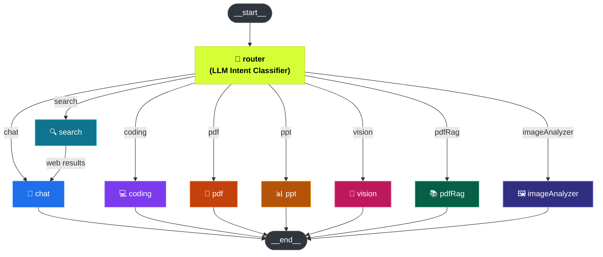

<p align="center">
  
</p>

<h1 align="center">◇ ORQIVA</h1>

<p align="center">
  <b>One interface. Multiple intelligent agents. Think beyond.</b>
</p>

<p align="center">
  
  
  
  
  
  
  
</p>

---

## 📖 Overview

**Orqiva** is a full-stack AI workspace platform built on a microservices architecture. It provides a unified chat interface that intelligently routes user queries to specialized AI agents — from general conversation and web search to code generation, PDF/PPT creation, and image analysis — all powered by a LangGraph-based agentic workflow.

---

## 🏗 Architecture

```
┌─────────────────────────────────────────────────────────────────┐
│                        FRONTEND (React 19 + Vite)               │
│   SideBar │ ChatArea │ Artifact │ BillingDrawer                 │
│   Firebase Auth (Google) · Redux Toolkit · TailwindCSS v4       │
└──────────────────────────┬──────────────────────────────────────┘
                           │ HTTP (Axios)
                           ▼
┌──────────────────────────────────────────────────────────────────┐
│                    API GATEWAY  (:8000)                          │
│   Express · CORS · Cookie-Parser · express-http-proxy · Morgan  │
│                                                                  │
│   /api/auth    ──▶  Auth Service   (:8001)                      │
│   /api/chat    ──▶  Chat Service   (:8002)   (protected)        │
│   /api/agent   ──▶  Agent Service  (:8003)   (protected)        │
│   /api/billing ──▶  Billing Service(:8004)   (protected)        │
│   /api/me      ──▶  Gateway (getCurrentUser) (protected)        │
└──────────────────────────────────────────────────────────────────┘
                           │
         ┌─────────────────┼─────────────────┐
         ▼                 ▼                 ▼
   ┌───────────┐    ┌───────────────┐    ┌───────────┐
   │  MongoDB  │    │  Redis Cloud  │    │ AWS S3    │
   │  (Atlas)  │    │  (redis.io)   │    │ (files)   │
   └───────────┘    └───────────────┘    └───────────┘
```

### Microservices

| Service     | Port   | Responsibilities                                                         |
| ----------- | ------ | ------------------------------------------------------------------------ |
| **Gateway** | `8000` | API routing, CORS, auth middleware, request proxying                     |
| **Auth**    | `8001` | Firebase Admin token verification, user CRUD, Redis session management   |
| **Chat**    | `8002` | Conversation & message persistence (MongoDB)                             |
| **Agent**   | `8003` | LangGraph agentic workflow, multi-agent routing, file processing         |
| **Billing** | `8004` | Razorpay payment order creation & verification, payment history          |

---

## 🤖 AI Agent System

The Agent service uses **LangGraph** (`@langchain/langgraph`) to build a stateful, graph-based workflow that routes user queries to the appropriate specialized agent.



### Available Agents

| Agent              | Purpose                                              | Key Tools / Deps                                             |
| ------------------ | ---------------------------------------------------- | ------------------------------------------------------------ |
| **Chat**           | General conversation & explanations                  | LangChain LLM (Google GenAI / Groq / OpenRouter)            |
| **Search**         | Real-time web search → feeds results into Chat       | `@langchain/tavily`                                          |
| **Coding**         | Code generation, debugging, architecture design      | LLM with code-focused prompts                                |
| **PDF**            | PDF document generation                              | `pdfkit`                                                     |
| **PPT**            | PowerPoint presentation generation                   | `pptxgenjs`                                                  |
| **Vision**         | Image generation / creation                          | Google Generative AI                                         |
| **PDF RAG**        | Upload & query PDF documents via RAG                 | `pdf-parse`, `@langchain/qdrant`, `@langchain/textsplitters` |
| **Image Analyzer** | Upload & analyze images                              | Multimodal LLM                                               |

> The **Router** uses an LLM to classify user intent, or falls back to file MIME-type detection for uploaded files (PDF → `pdfRag`, images → `imageAnalyzer`). Users can also manually select an agent to bypass auto-routing. The **Search** agent pipes web results into **Chat** before responding.

---

## 🖥 Frontend

| Technology                   | Usage                                        |
| ---------------------------- | -------------------------------------------- |
| **React 19**                 | UI framework                                 |
| **Vite 8**                   | Build tooling & dev server                   |
| **TailwindCSS v4**           | Utility-first styling                         |
| **Redux Toolkit**            | Global state (user, conversations, messages) |
| **Firebase**                 | Google OAuth sign-in (client-side)           |
| **Monaco Editor**            | Code artifact rendering                      |
| **React Markdown**           | Markdown message rendering with GFM          |
| **React Syntax Highlighter** | Code block highlighting                      |
| **Framer Motion**            | Animations & transitions                     |
| **Lucide React**             | Icon system                                  |
| **Axios**                    | HTTP client (with credentials)               |

### Key Components

- **`SideBar`** — Conversation list, new chat, agent selection
- **`ChatArea`** — Main message thread & input
- **`ChatInput`** — Message composer with file upload
- **`MessageBubble`** — Rendered AI/user messages with markdown
- **`Artifact`** — Side panel for generated artifacts (code, documents)
- **`BillingDrawer`** — Usage & payment management via Razorpay
- **`LoadingAnimation`** — AI thinking indicator

---

## 🚀 Getting Started

### Prerequisites

- **Node.js** ≥ 18
- **MongoDB Atlas** account (or any MongoDB URI)
- **Redis Cloud** account at [redis.io](https://redis.io) (free tier works)
- **Firebase** project with Google sign-in enabled
- **Razorpay** account (for billing features)

### 1. Clone the repository

```bash
git clone https://github.com/<your-username>/Orqiva.git
cd Orqiva
```

### 2. Configure environment variables

Each service has its own `.env` file. Create/update the following:

<details>
<summary><b>backend/gateway/.env</b></summary>

```env
PORT=8000
AUTH_SERVICE=http://localhost:8001
CHAT_SERVICE=http://localhost:8002
AGENT_SERVICE=http://localhost:8003
BILLING_SERVICE=http://localhost:8004
FRONTEND_URL="http://localhost:5173"
REDIS_URL="redis://<username>:<password>@<host>:<port>"
```

</details>

<details>
<summary><b>backend/services/auth/.env</b></summary>

```env
PORT=8001
MONGODB_URI=<your-mongodb-atlas-connection-string>
REDIS_URL="redis://<username>:<password>@<host>:<port>"
FIREBASE_PROJECT_ID=<your-firebase-project-id>
FIREBASE_CLIENT_EMAIL=<your-service-account-client-email>
FIREBASE_PRIVATE_KEY="<your-service-account-private-key>"
```

> Store the Firebase private key with `\n` in place of line breaks and keep it quoted. Do not commit this file.

</details>

<details>
<summary><b>backend/services/chat/.env</b></summary>

```env
PORT=8002
MONGODB_URI=<your-mongodb-atlas-connection-string>
REDIS_URL="redis://<username>:<password>@<host>:<port>"
```

</details>

<details>
<summary><b>backend/services/agent/.env</b></summary>

```env
PORT=8003
MONGODB_URI=<your-mongodb-atlas-connection-string>
REDIS_URL="redis://<username>:<password>@<host>:<port>"
GOOGLE_API_KEY=<your-google-genai-key>
GROQ_API_KEY=<your-groq-key>
OPENROUTER_API_KEY=<your-openrouter-key>
TAVILY_API_KEY=<your-tavily-key>
QDRANT_URL=<your-qdrant-url>
QDRANT_API_KEY=<your-qdrant-api-key>
AWS_REGION=<your-aws-region>
AWS_ACCESS_KEY_ID=<your-aws-key>
AWS_SECRET_KEY=<your-aws-secret>
AWS_BUCKET_NAME=<your-bucket-name>
```

</details>

<details>
<summary><b>backend/services/billing/.env</b></summary>

```env
PORT=8004
MONGODB_URI=<your-mongodb-atlas-connection-string>
RAZORPAY_KEY_ID=<your-razorpay-key>
RAZORPAY_KEY_SECRET=<your-razorpay-secret>
```

</details>

<details>
<summary><b>frontend/.env</b></summary>

```env
VITE_FIREBASE_API_KEY=<your-firebase-api-key>
VITE_SERVER_URL="http://localhost:8000"
VITE_RAZORPAY_KEY_ID=<your-razorpay-key-id>
```

</details>

> **Redis URL** — Get your connection string from the [Redis Cloud console](https://app.redis.io) under your database → **Connect**. The format is `redis://default:<password>@<host>:<port>`.

### 3. Install dependencies & start services

**Backend** — run each service in a separate terminal:

```bash
# Gateway
cd backend/gateway && npm install && npm run dev

# Auth Service
cd backend/services/auth && npm install && npm run dev

# Chat Service
cd backend/services/chat && npm install && npm run dev

# Agent Service
cd backend/services/agent && npm install && npm run dev

# Billing Service
cd backend/services/billing && npm install && npm run dev
```

**Frontend:**

```bash
cd frontend && npm install && npm run dev
```

The app will be available at **http://localhost:5173**.

---

## 📁 Project Structure

```
Orqiva/
├── backend/
│   ├── gateway/                    # API Gateway (port 8000)
│   │   ├── config/
│   │   │   └── redis.js            # Redis Cloud client
│   │   ├── controllers/
│   │   ├── middleware/             # Auth middleware (session check)
│   │   ├── utils/                  # Proxy helpers
│   │   └── index.js
│   └── services/
│       ├── auth/                   # Auth Service (port 8001)
│       │   ├── config/
│       │   │   ├── db.js
│       │   │   ├── firebase.js
│       │   │   └── redis.js        # Redis Cloud client
│       │   ├── controllers/
│       │   ├── models/             # User model
│       │   ├── routes/
│       │   └── index.js
│       ├── chat/                   # Chat Service (port 8002)
│       │   ├── config/
│       │   ├── controllers/
│       │   ├── models/             # Conversation, Message models
│       │   ├── routes/
│       │   └── index.js
│       ├── agent/                  # Agent Service (port 8003)
│       │   ├── agents/             # 8 specialized AI agents
│       │   ├── config/
│       │   │   ├── redis.js        # Redis Cloud client
│       │   │   ├── memory.js       # Conversation memory (Redis)
│       │   │   └── agentLimit.js   # Rate limiting (Redis)
│       │   ├── controllers/
│       │   ├── graph/              # LangGraph workflow
│       │   │   ├── graph.js        # StateGraph definition
│       │   │   ├── router.js       # Intent classifier
│       │   │   └── state.js        # Agent state schema
│       │   ├── routes/
│       │   ├── utils/
│       │   └── index.js
│       └── billing/                # Billing Service (port 8004)
│           ├── config/
│           ├── controllers/
│           ├── models/             # Payment model
│           ├── routes/
│           └── index.js
└── frontend/
    ├── public/
    ├── utils/                      # Firebase config, Axios instance
    ├── src/
    │   ├── components/             # UI components
    │   ├── features/               # API call functions
    │   ├── pages/                  # Page components
    │   ├── redux/                  # Store, slices (user, conversation, message)
    │   ├── styles/
    │   ├── App.jsx
    │   └── main.jsx
    ├── index.html
    └── vite.config.js
```

---

## 🔑 Key API Routes

| Method | Endpoint              | Auth | Service | Description                   |
| ------ | --------------------- | ---- | ------- | ----------------------------- |
| POST   | `/api/auth/login`     | ✗    | Auth    | Firebase token → session      |
| GET    | `/api/me`             | ✓    | Gateway | Get current user              |
| GET    | `/api/chat/`          | ✓    | Chat    | List conversations            |
| POST   | `/api/chat/`          | ✓    | Chat    | Create conversation           |
| PUT    | `/api/chat/:id`       | ✓    | Chat    | Update conversation           |
| GET    | `/api/chat/:id`       | ✓    | Chat    | Get messages                  |
| POST   | `/api/agent/`         | ✓    | Agent   | Send message → agent pipeline |
| POST   | `/api/billing/order`  | ✓    | Billing | Create Razorpay order         |
| POST   | `/api/billing/verify` | ✓    | Billing | Verify payment                |

---

## 🛠 Tech Stack Summary

| Layer        | Technologies                                                                                       |
| ------------ | -------------------------------------------------------------------------------------------------- |
| **Frontend** | React 19, Vite 8, TailwindCSS v4, Redux Toolkit, Firebase Auth, Monaco Editor                    |
| **Gateway**  | Express 5, express-http-proxy, cookie-parser, cors, morgan, ioredis                               |
| **Auth**     | Express 5, Firebase Admin SDK, Mongoose, ioredis                                                  |
| **Chat**     | Express 5, Mongoose                                                                                |
| **Agent**    | Express 5, LangGraph, LangChain (Google GenAI, Groq, OpenRouter, Tavily, Qdrant), pdfkit, pptxgenjs, AWS S3 |
| **Billing**  | Express 5, Mongoose, Razorpay SDK                                                                  |
| **Infra**    | MongoDB Atlas, Redis Cloud (redis.io), AWS S3                                                     |

---

## 📄 License

ISC

---

<p align="center">
  <b>In production (Arpit Sharma) ... Deployed soon.....</b>
</p>
